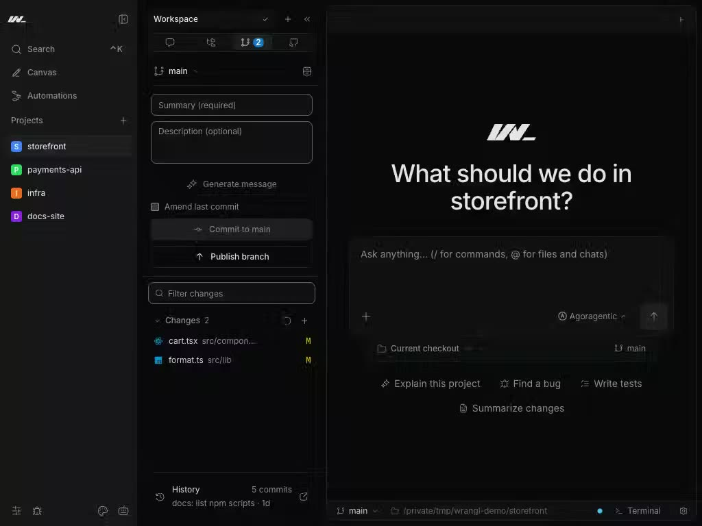

# Wrangl

Wrangl is a desktop workspace for coding. Each project gets its own terminals, editor tabs, git and worktree tools, and chats with ACP coding agents (Claude Agent, Codex, Gemini CLI, Cursor, OpenCode and others). It also does SSH and SFTP, and `wrangl-server` serves the same workspace to a browser or a phone.

Runs on Windows, macOS and Linux. Built with Tauri 2, React and Rust.

Wrangl is built for trading on Robinhood Chain: agents read the chain, and you sign the transactions they propose in your own wallet. See the [Robinhood Chain docs](https://wrangl-docs.pages.dev/docs/robinhood-chain).



[Website](https://wrangl-landing.pages.dev) · [Docs](https://wrangl-docs.pages.dev/docs/) · [Changelog](https://wrangl-docs.pages.dev/docs/changelog) · [X @usewrngl](https://x.com/usewrngl) · [Discussions](https://github.com/wrangl-dev/wrangl/discussions)

## Install

See the [install guide](https://wrangl-docs.pages.dev/docs/getting-started/install) for every option. The quickest ones:

```bash
# macOS and Linux
curl -fsSL https://raw.githubusercontent.com/wrangl-dev/wrangl/main/scripts/install.sh | bash
```

```powershell
# Windows (PowerShell)
irm https://raw.githubusercontent.com/wrangl-dev/wrangl/main/scripts/install.ps1 | iex
```

```bash
# Any platform, with Node.js 18+
npx @wrangl-dev/wrangl
```

Each one installs the latest release and checks it against the release checksums. Installers are also on the [releases page](https://github.com/wrangl-dev/wrangl/releases/latest).

To run the server in Docker, see [`docs/deployment-guide.md`](docs/deployment-guide.md).

## Build from source

### Prerequisites

You need [Bun](https://bun.sh) 1.3+ and a stable [Rust](https://www.rust-lang.org/tools/install) toolchain, plus the Tauri system packages for your OS:

- macOS: `xcode-select --install`
- Windows: Visual C++ Build Tools and the WebView2 runtime
- Debian/Ubuntu:
  ```bash
  sudo apt install libwebkit2gtk-4.1-dev build-essential curl wget file \
      libxdo-dev libssl-dev libayatana-appindicator3-dev librsvg2-dev patchelf
  ```

The agent browser needs WebKitGTK 2.40 or later at runtime on Linux.

### Build

```bash
git clone https://github.com/wrangl-dev/wrangl.git
cd wrangl
bun install
bun run dev        # run the app in development mode
bun run build      # build installers into src-tauri/target/release/bundle/
```

Other useful scripts:

```bash
bun run test       # unit tests (vitest)
bun run typecheck
bun run check      # biome lint + format
```

More docs: [`docs/`](docs/index.md) and [`CONTRIBUTING.md`](CONTRIBUTING.md).

## Report a bug

Use **Report a bug** at the bottom of the app's left sidebar, or [open an issue](https://github.com/wrangl-dev/wrangl/issues/new/choose). No GitHub account? DM [@usewrngl on X](https://x.com/usewrngl). Details are in [Report a problem](https://wrangl-docs.pages.dev/docs/troubleshooting/report-a-problem).

## License

MIT, see [LICENSE](LICENSE).
